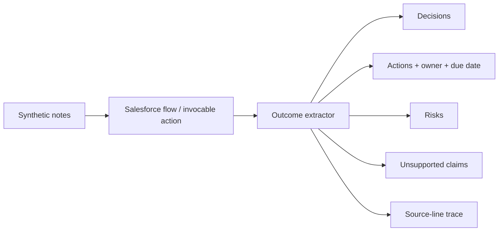

# Agentforce Meeting Intelligence

> A focused Salesforce Agentforce reference that turns synthetic meeting transcripts into traceable decisions, action items, risks, and rejected unsupported claims.



## Quickstart

```bash
make test
make eval
make validate
make demo
```

The local reference has no dependencies, credentials, network calls, or real meeting data.

## What I built

- Idempotent processing keyed by transcript hash.
- Strict action syntax that prevents invented owners and due dates.
- Source-line traceability for every extracted outcome.
- Explicit rejection of assumptions and guesses.
- Minimal Apex invocable action and tests.
- Twenty evaluation tasks run across three trials.

## Evidence

The offline report records 60/60 successful trials, source-trace checks, unsupported-claim rejection, and idempotency outcomes in `evals/results.json`.

## What is mocked

The deterministic processor stands in for a prompt/model. Salesforce deployment requires an Agentforce-enabled development org, but all CI checks run offline.

## Known limitations

This parser demonstrates the contracts and safety behavior; it is not intended to replace a production transcription or language model service.

See [SECURITY.md](SECURITY.md) and [PROVENANCE.md](PROVENANCE.md).
